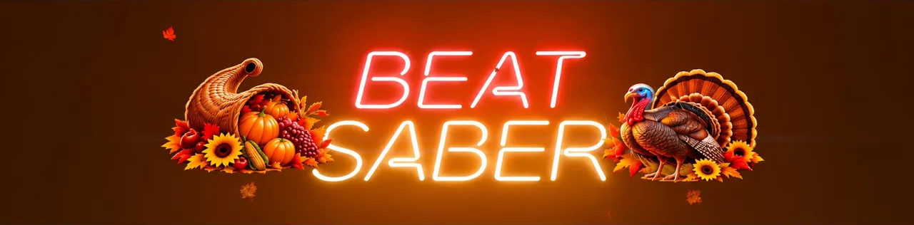

## 🦃 Thanksgiving Theme — Video

Watch Thanksgiving Theme in action!

[](https://www.youtube.com/watch?v=t5VIwbuC9vc)

▶️ **Watch on YouTube:** https://www.youtube.com/watch?v=t5VIwbuC9vc

Happy Thanksgiving!

Transform your Beat Saber menu with golden harvest lighting, seasonal decorations, and falling leaves!

Based on the fantastic Christmas Mod by vcmikuu laynia.

Note: Development assisted with use of A.I. Please support talented artists and coders whenever possible.

**Compatible with:** Beat Saber 1.40.8 (Quest)

## Building from source

This is the Beat Saber Quest source project. The supported baseline is Beat Saber **1.40.8**.

Requirements:
- QPM CLI (the GitHub Actions workflow currently pins QPM v1.5.12)
- Android NDK 27.3.13750724
- CMake 3.22 or newer
- Ninja
- Python 3

From the repository root, run:

```sh
qpm ndk resolve -d
qpm restore
qpm qmod zip
```

The QMOD output is configured as `Thanksgiving.qmod`. The two turkey audio clips are stored under `assets/` and referenced by their full archive paths in `mod.json`.

GitHub Actions builds and validates the QMOD on pushes and pull requests. Pushing a version tag (for example, `v1.0.1`) builds the package and publishes it with a source ZIP. Update the `version` in `mod.json` to match the tag before creating a release.
